# Diagramas — Klass / ft_trascendence

Vista del LMS a 2026-09-20. El copy de producto es **«Tarea»**; en Prisma y Nest la instancia sigue llamándose `Activity`. Las escrituras a `Assignment` / `Submission` responden **410**; las tablas siguen por GET y por la migración.

Fuente de verdad del esquema: [`apps/backend/prisma/schema.prisma`](../apps/backend/prisma/schema.prisma).  
Ciclo de tareas: [`planning/task-templates.md`](./planning/task-templates.md).

---

## 1. Base de datos

### 1.1 Mapa de dominios

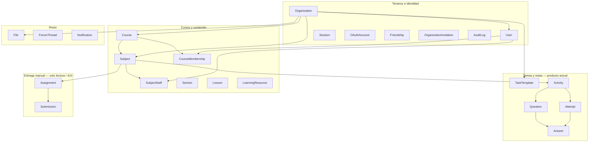

Tenancy: `organizationId` en org, usuario, fichero y plantilla. El resto se aísla **en la app** (via curso → org), no con RLS de Postgres.

### 1.2 ER — núcleo (org, curso, fichero)

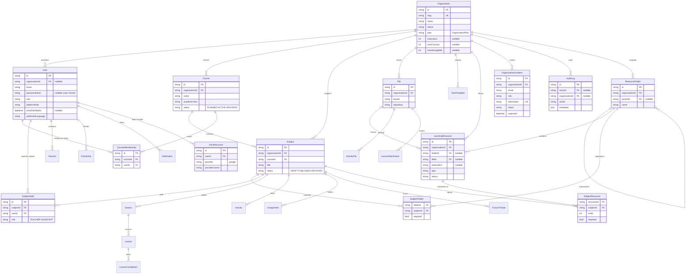

Los bytes no viven en Postgres: `File` es `bucket` + `objectKey` (Garage/S3 o disco local).

Biblioteca: `Organization → ResourceFolder (anidable por parentId) → LearningResource`. Una carpeta se asigna a asignaturas con `SubjectFolder`; un recurso suelto se publica en asignaturas con `SubjectResource`. El recurso apunta a un `File` subido o a una `externalUrl`.

### 1.3 ER — tareas, plantillas y notas

Tres objetos que no se mezclan: **plantilla** (receta), **actividad** (instancia en un curso), **intento** (nota del alumno).

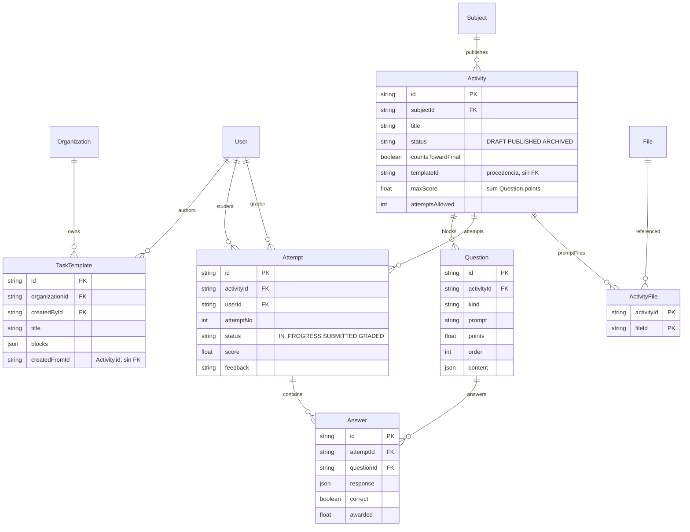

`Question.kind`: `MULTIPLE_CHOICE`, `TRUE_FALSE`, `FILL_BLANK`, `MATCHING`, `ORDERING`, `SHORT_ANSWER`, `ESSAY`, `FILE_UPLOAD`.  
`LISTENING` / `SPEAKING` están en `ActivityType` y no tienen adaptador aún.

`Assignment` / `Submission` / `AssignmentFile` / `SubmissionFile` siguen en el esquema (GET). Las mutaciones HTTP son 410.

---

## 2. Componentes

### 2.1 Contenedores (runtime)

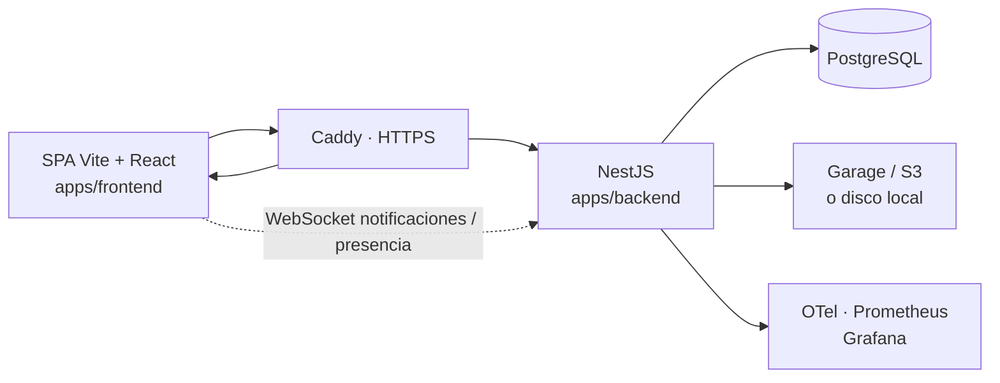

En local sin proxy la SPA habla con el API en `:3000`. Compose: Caddy termina TLS.

### 2.2 Módulos Nest y dueños

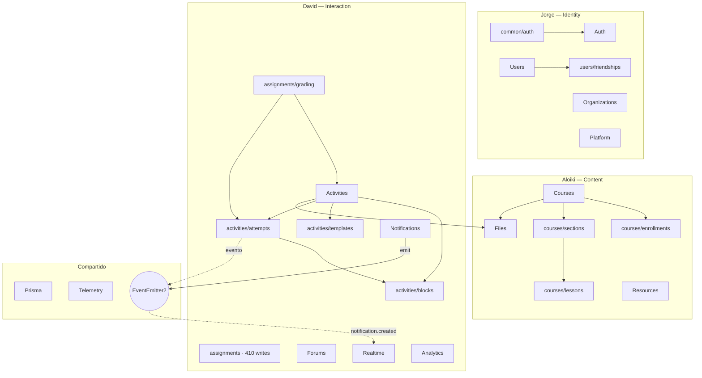

Frontend (mismas superficies): `features/activities` (Tareas + biblioteca + reproductor), `gradebook`, `grades`, `courses`, `auth`, `org`, `forums`, `notifications`, `dashboard`, `admin`, `platform`, `profile`, `resources`, `friends`, `presence`, `legal`, `analytics`. `/assignments` redirige a `/activities`.

### 2.3 Registro de bloques (seam)

Añadir un tipo de pregunta = un adaptador. El ciclo crear → intentar → calificar no se toca.

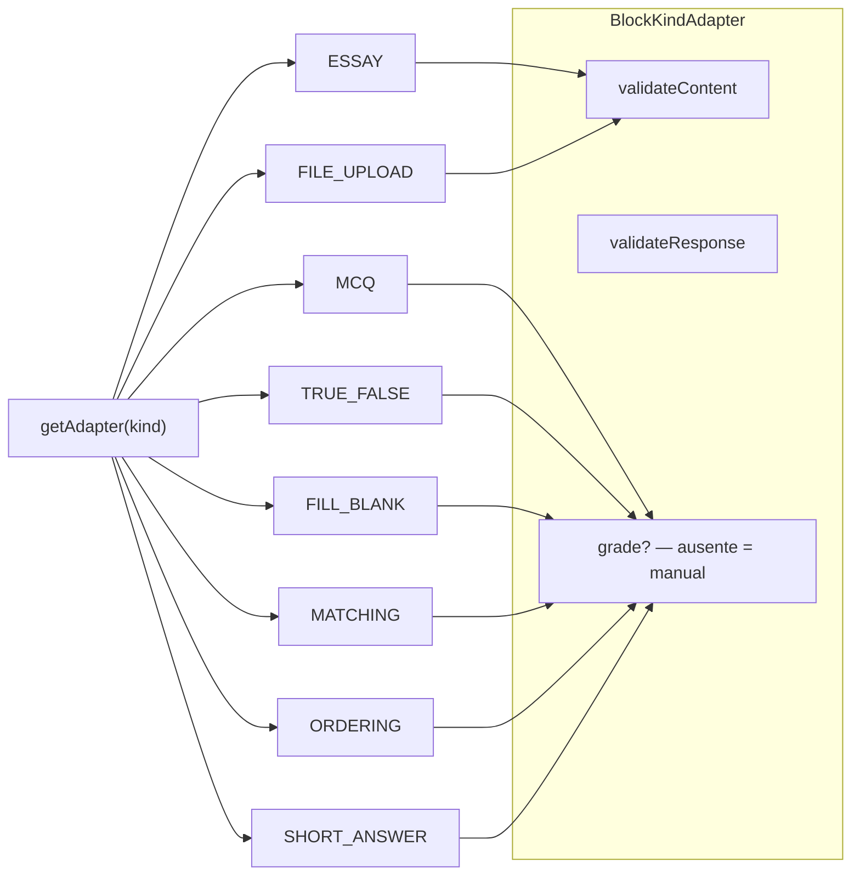

Editor y reproductor en el frontend: `kind → { Editor, Player }`.

---

## 3. Flujos

### 3.1 Ciclo de una tarea (profesor + alumno)

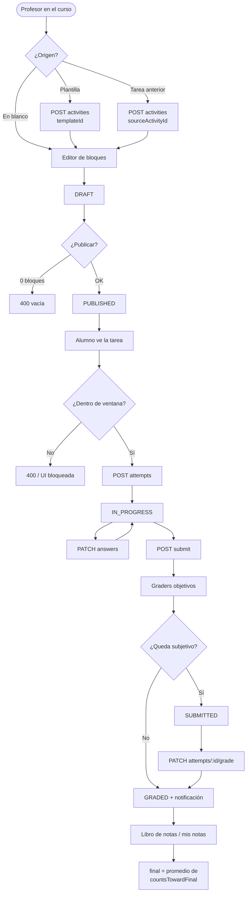

Instanciar o guardar como plantilla **copia bloques**, no intentos ni notas. Con intentos ya existentes, mutar bloques → **409**; título, fechas y `countsTowardFinal` sí.

### 3.2 Secuencia: examen mixto (test + desarrollar)

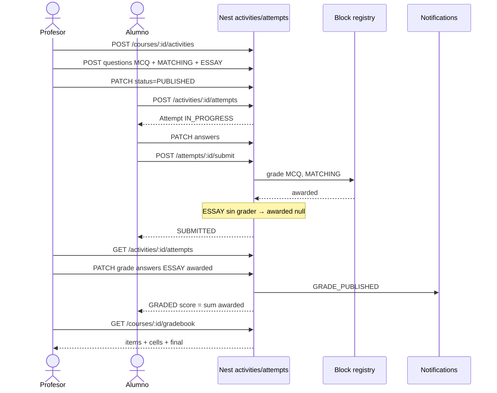

### 3.3 Nota final (vista, no columna guardada)

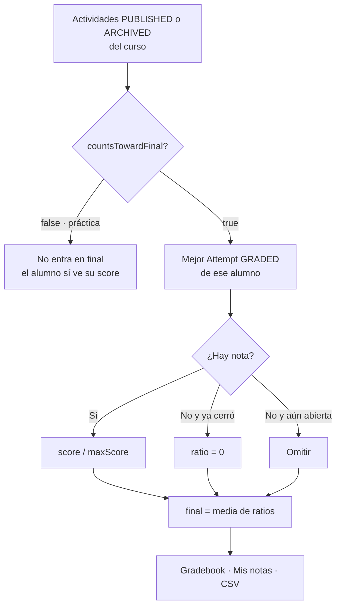

Cerrado = `now > closeAt`, o si no hay `closeAt` y `now > dueAt`. Ambos null → no cerrado.

### 3.4 Plantillas (guardar y reutilizar)

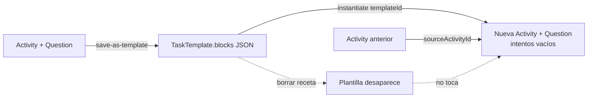

RBAC breve: listar/instanciar plantillas = staff de algún curso de la org. Editar/borrar = autor o `ADMIN` de la org. Instanciar exige staff del **curso destino**. Cross-org → 404.

---

### 3.5 Autenticación: login, refresh, logout y recuperación

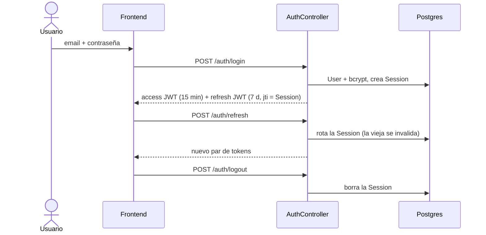

```mermaid
sequenceDiagram
  actor U as Usuario
  participant A as Auth
  participant N as Notificaciones
  actor Ad as Admin de la org
  U->>A: POST /auth/forgot-password (email)
  A-->>U: misma respuesta exista o no (anti-enumeración)
  A->>N: avisa a los admins (sin SMTP)
  Ad->>A: POST /auth/admin/users/:id/password-reset
  A-->>Ad: enlace con JWT purpose=password-reset
  Ad-->>U: le pasa el enlace
  U->>A: POST /auth/password-reset (token + nueva)
  A->>A: verifica firma, caducidad y huella del hash
  A-->>U: contraseña cambiada; el enlace ya no vale
```

No hay tabla de reset: el token es un JWT firmado que lleva una huella del `passwordHash` actual, así que al cambiar la contraseña deja de ser válido (un solo uso). Las invitaciones sí se guardan (`OrganizationInvitation.tokenHash`) y se aceptan con `POST /auth/invitations/:token/accept`. Google OAuth usa un `state` firmado y el botón solo aparece si hay `GOOGLE_CLIENT_ID`.

## Cómo verlos

GitHub, GitLab y Obsidian renderizan los bloques `mermaid`. En local: extensión Markdown Preview Mermaid, o [mermaid.live](https://mermaid.live) pegando un bloque.
