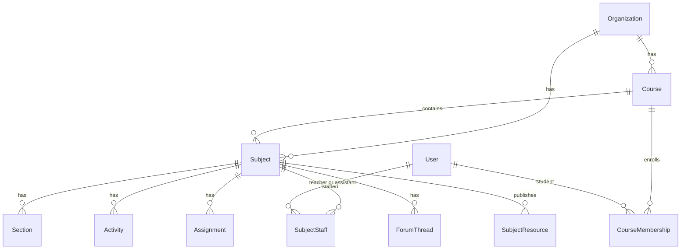

# ERD — Course, Subject, membership, staff

`Course` is a cohort (name + academic year). `Subject` is the old teaching container, renamed, and it belongs to exactly one course. The fuller diagram is in [`docs/diagrams.md`](../diagrams.md).

There is no `Enrollment`, `ownerId`, `accessCode`, or `CourseRole`. Progress is computed from `LessonCompletion`.
