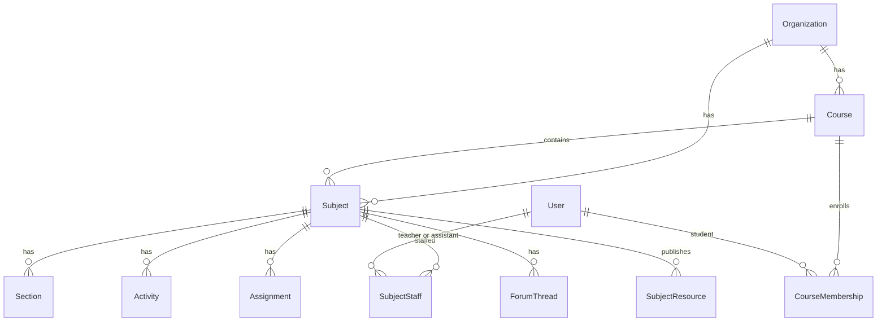

# Informe preliminar — Curso = año académico, Asignatura = el `Course` actual

Issue [#32](https://github.com/Klass42/ft_trascendence/issues/32). Al aprobar este plan, el único cambio en el repo es guardar este informe en `docs/planning/2026-09-25-curso-asignatura.md`. No se toca el esquema, la API ni la UI hasta que pidas implementar.

## Decisiones que asumo (corrígelas al revisar)

1. **Un curso es una cohorte**: nivel + grupo + año académico. Ejemplo: `1º ESO A · 2025-2026`. Un alumno tiene un curso activo y conserva los anteriores.
2. **La asignatura es la fila actual de `Course`, renombrada**, colgando de un solo curso. Matemáticas de 1º A y Matemáticas de 2º B son dos filas. Un catálogo reutilizable queda fuera de este cambio.
3. **El alumno se matricula en el curso y ve todas las asignaturas publicadas de ese curso.** Las optativas (matrícula asignatura a asignatura) quedan fuera.
4. **Solo el admin de la organización crea cursos, asignaturas y asigna profesores** ([#28](https://github.com/Klass42/ft_trascendence/issues/28)). El profesor crea el contenido de las asignaturas en las que está asignado.
5. **Se elimina `accessCode`** (auto-matrícula por código). La matrícula la hace el admin.
6. **Se elimina `ownerId`.** El profesorado vive solo en la asignación a la asignatura, para no tener dos fuentes de “quién imparte”.

Si 1, 2 o 3 cambian, cambia el esquema. 4–6 se pueden revertir sin rehacer el modelo.

## Qué hay hoy

`Course` en `apps/backend/prisma/schema.prisma` es el contenedor docente: título, descripción, categoría, imagen, `accessCode`, estado `DRAFT | PUBLISHED | ARCHIVED`, `ownerId`, y de él cuelgan secciones, lecciones, matrículas, tareas, actividades, foros y `CourseResource`.

`Enrollment` une usuario y curso con rol `TEACHER | ASSISTANT | STUDENT` y un `progress` 0–100. El mismo registro sirve para “imparte” y para “está matriculado”.

No existe año académico. El comentario del esquema lo deja en fase 2 (“academic periods”). Este cambio lo adelanta solo como cohorte con fechas, sin calendario, asistencia ni certificados.

`GET /courses` (`courses.service.ts`, `findAll`) devuelve, para quien no es admin, todo lo `PUBLISHED` de la organización, más lo que posee o imparte. Un alumno ve asignaturas en las que no está. Un profesor ve las publicadas de otros. Eso es el selector roto de [#21](https://github.com/Klass42/ft_trascendence/issues/21) y [#23](https://github.com/Klass42/ft_trascendence/issues/23) (calificaciones, foros, tareas, analítica, recursos).

`POST /courses` crea el registro, pone al creador como `ownerId` y lo matricula como `TEACHER`. El botón “Crear curso” de `/courses` es el de [#28](https://github.com/Klass42/ft_trascendence/issues/28).

El contenedor docente aparece como `courseId` en **91 archivos** `.ts`/`.tsx` (API, hooks, páginas, e2e, seed). Hay historial Prisma real (`apps/backend/prisma/migrations/`, cinco migraciones; la tabla nace en `20260715195038_init`). El contenedor arranca con `prisma migrate deploy` (`apps/backend/Dockerfile`, `make` seed). `make db-push` sigue existiendo: un `db push` interpretaría el renombre como borrar `Course` y crear otra tabla.

`CourseStatus` lo reutiliza `Activity.status`. Renombrar el enum a ciegas rompe las actividades.

Identificadores de código y base de datos en inglés (`Course`, `Subject`). La interfaz sigue en español (Curso, Asignatura).

## Propuesta

### `Course` (tabla nueva) — año / cohorte

| Campo | Notas |
|---|---|
| `id` | cuid |
| `organizationId` | obligatorio; toda query filtra por él |
| `name` | `1º ESO A` |
| `academicYear` | `2025-2026` |
| `startsOn`, `endsOn` | date. El curso actual es el `ACTIVE` cuya ventana contiene hoy |
| `status` | enum nuevo `CohortStatus`: `PLANNED`, `ACTIVE`, `ARCHIVED` |
| `createdAt`, `updatedAt` | |

Único: `(organizationId, name, academicYear)`.

### `Subject` (la tabla `Course` renombrada)

Se conserva el contenido actual y se añade `courseId` obligatorio hacia `Course`. Se mantienen `organizationId` (filtro de tenant directo; el servicio comprueba que coincida con el del curso), `title`, `description`, `category`, `imageUrl`, `status`, secciones, lecciones, actividades, entregas, foros.

Salen `ownerId` y `accessCode`.

`CourseResource` pasa a `SubjectResource` (`subjectId`). La biblioteca (`LearningResource`) sigue siendo de la organización.

### Personas

- **`CourseMembership`**: alumno ↔ curso. Único `(courseId, userId)`. Un usuario solo puede tener una membresía en cursos `ACTIVE` de su organización (regla de servicio; Prisma no expresa índice parcial). Al archivar el curso, la fila se queda: es el historial de “Mis cursos”.
- **`SubjectStaff`**: profesor o asistente ↔ asignatura. Único `(subjectId, userId)`. Rol `TEACHER | ASSISTANT` (enum `SubjectStaffRole`, el actual `CourseRole` sin `STUDENT`).
- El progreso deja de guardarse en la matrícula. `LessonCompletion` ya registra lección y usuario; el porcentaje se calcula. Se quita el `Float progress`.

El alumno entra en una asignatura publicada si tiene `CourseMembership` en el curso padre. El profesor entra si tiene `SubjectStaff` en esa asignatura. El admin de la organización entra en todos los cursos y asignaturas de su org.

### Navegación (lo que pide #32)

- **Alumno, `/courses`:** bloque “Curso actual” y bloque “Cursos anteriores”. Dentro del curso, todas las asignaturas `PUBLISHED`.
- **Profesor, `/courses`:** cursos en los que tiene al menos una `SubjectStaff`. Dentro del curso, solo las asignaturas que imparte ahí. Puede pasar de un curso a otro.
- **Admin:** todos los cursos de la org. Dentro, todas las asignaturas. Botones de crear curso, crear asignatura, matricular alumnos y asignar profesores. Esos botones no se renderizan para profesor ni alumno.

Los selectores de calificaciones, foros, tareas, analítica y biblioteca dejan de usar “todos los publicados”. Pasan a `GET /me/subjects`, cada opción etiquetada `Matemáticas · 1º ESO A · 2025-2026`. Con eso #21 y #23 quedan cubiertos por el mismo modelo, sin un parche aparte del selector.

## API

Corte limpio. No hay clientes externos; hay e2e y el seed. Mantener `/courses/:id` como “la asignatura” dejaría el nombre mentiroso.

| Antes | Después |
|---|---|
| `GET/POST /courses` | `GET/POST /courses` = cohortes. `POST` solo admin |
| `GET/PATCH/DELETE /courses/:id` | el curso (año). `PATCH/DELETE` solo admin |
| — | `GET/POST /courses/:courseId/subjects`. `POST` solo admin |
| — | `GET/PATCH/DELETE /subjects/:subjectId` |
| — | `POST /courses/:courseId/members`, `DELETE` de esa membresía. Solo admin |
| — | `POST /subjects/:subjectId/staff`, `PATCH` rol, `DELETE`. Solo admin |
| — | `GET /me/courses`, `GET /me/subjects` (listas ya filtradas por rol) |
| `/courses/:courseId/sections`, lecciones, actividades, gradebook, foros, analytics, resources, enroll | el id pasa a ser `subjectId`: `/subjects/:subjectId/...` |
| `POST /courses/:id/enroll` y `accessCode` | desaparecen |
| `GET /courses/:id/preview` | desaparece con el código de auto-matrícula |

Autorización en un solo sitio (hoy `CourseAccessService`), partido en lectura de curso y lectura/staff de asignatura. El resto de módulos llama a ese helper. Cada query de cohorte o asignatura sigue filtrando `organizationId`.

Quién hace qué:

| Acción | Admin org | Profesor | Alumno |
|---|---|---|---|
| Crear curso o asignatura, matricular, asignar profesor | sí | no | no |
| Ver cursos | todos los de la org | aquellos donde imparte una asignatura | aquellos donde está matriculado |
| Ver asignaturas de un curso | todas | las que imparte | las publicadas del curso |
| Lecciones, tareas, actividades, foro (escribir) | sí | si es staff de esa asignatura | foro y entregas, si pertenece al curso |
| Analítica y libro de notas de la asignatura | sí | si es staff | sus propias notas |

## Migración

Una migración SQL escrita a mano. La que genera Prisma para un renombre suele ser `DROP TABLE "Course"` + `CREATE TABLE`. Hay que sustituirla por:

1. `ALTER TABLE "Course" RENAME TO "Subject"`, y renombrar índices, FKs y el unique de `accessCode` antes de soltar esa columna.
2. `ALTER TYPE "CourseStatus" RENAME TO "PublicationStatus"` (lo usan asignatura y actividad).
3. Crear el enum `CohortStatus` y la tabla nueva `"Course"`.
4. Añadir `Subject.courseId`. Rellenar: por cada organización, un curso `ACTIVE` del año en curso y colgar ahí todas las asignaturas existentes.
5. Crear `CourseMembership` con los `Enrollment` de rol `STUDENT`, y `SubjectStaff` con los de rol `TEACHER`/`ASSISTANT` más los `ownerId` que no tuvieran fila.
6. Renombrar columnas `courseId` → `subjectId` en Section, Assignment, Activity, ForumThread, Enrollment (que desaparece), CourseResource (que pasa a SubjectResource).
7. Borrar `Enrollment`, `ownerId`, `accessCode`.

Volúmenes locales de demo: después de la migración, `prisma migrate deploy` y volver a ejecutar el seed, o aceptar el backfill genérico del paso 4. `make db-push` en esta rama borra datos.

El seed (`apps/backend/prisma/seed.ts`, escenario estándar `course-web-101` y el generador de instituciones) pasa a contar historias de cohortes:

- Klass: curso `1º A · 2025-2026` (`ACTIVE`) con la asignatura que hoy es `course-web-101`; curso `1º A · 2024-2025` (`ARCHIVED`) con una asignatura pasada, para que el alumno vea historial.
- Sam (`student@demo`) matriculado en ambos. Theo (`teacher@demo`) staff de la asignatura vigente, así que en “Mis cursos” ve el año 2025-2026.
- Instituciones grandes: varias cohortes, varias asignaturas por cohorte, cada profesor en un subconjunto, cada alumno en una cohorte activa.

## Cambios por zona (cuando se implemente)

Esto no forma parte de la aprobación de este informe. Es el inventario.

**Esquema y datos (Jorge)**
- `apps/backend/prisma/schema.prisma`
- migración nueva en `apps/backend/prisma/migrations/`
- `apps/backend/prisma/seed.ts` y `migrate-assignments-to-activities.ts` (sigue apuntando a `courseId`)
- comentario de “academic periods” del propio esquema y la línea equivalente en `AGENTS.md` §5: el año académico entra; calendario, asistencia y certificados siguen fuera

**Acceso y módulos que hoy reciben `courseId` (Jorge, con David en actividades/foros/notas)**
- `apps/backend/src/courses/` entero (`courses.service.ts`, `course-access.service.ts`, enrollments, sections, lessons, DTOs, specs)
- `activities/` (controller, service, attempts, templates, DTOs)
- `assignments/` y `grading/`
- `forums/`
- `analytics/`
- `resources/` (`CourseResource`, publish/unpublish)
- enlaces guardados en `Notification.link` (`/courses/...` en el seed y al crear avisos)

**Frontend (Aloiki en cursos y shell; David en selectores de interacción)**
- Rutas en `apps/frontend/src/app/routes.tsx`: `/courses`, `/courses/:courseId`, `/courses/:courseId/subjects/:subjectId`, lección anidada. La etiqueta de nav “Cursos” se queda.
- `features/courses/` (lista, detalle, roster, editor, lección). El detalle actual de curso pasa a ser la página de asignatura.
- Hooks y tipos: `lib/api/hooks/useCourses.ts` y el resto de hooks con `courseId`; `lib/api/types/course.ts`, `activity.ts`, `assignment.ts`, `forum.ts`, `resource.ts`, `gradebook.ts`, `task-template.ts`
- Selectores que llaman `useCourses()`: `GradesPage`, `GradebookPage`, `ForumsPage`, `ActivitiesPage`, `AssignmentsPage`, `AnalyticsPage`, `ResourcesPage`, `StudentDashboard`, `AdminDashboard`
- Quitar “Crear curso” salvo `GlobalRole.ADMIN`

**Pruebas**
- Specs de backend listados arriba
- e2e: `courses.spec.ts`, `course-authoring.spec.ts`, `roster.spec.ts`, `content-builder.spec.ts`, `tasks.spec.ts`, `activities-authoring.spec.ts`, `assignments-authoring.spec.ts`, `student-dashboard.spec.ts`, `teacher-dashboard.spec.ts`, `compose-tenant-rbac.spec.ts`. Los IDs fijos `course-web-101` cambian de significado (pasan a ser asignatura) o se renombran

**Documentación (cuando el comportamiento exista, no ahora)**
- `docs/diagrams/ERD.md` y casos de uso `student.md` / `teacher.md` / `admin.md`
- `docs/planning/Aloiki.md`, `David.md`, `Jorge.md` donde describen el curso como asignatura
- `docs/errors/*` que citan `GET /api/courses/:id/...`
- `docs/planning/task-templates.md` y la spec de tareas (rutas)
- `MVP_DESIGN.md` sigue siendo fuente secundaria; no hace falta reescribirlo

`infra/`, `.github/`, `Makefile` y `flake.nix` no entran. Ale no tiene tarea salvo que el bootstrap de compose vuelva a divergir de `migrate deploy`.

## Cómo partir el trabajo más adelante

Un solo PR a `staging`. Partirlo en tres merges deja la API y la UI en nombres distintos. Orden dentro de la rama: migración y seed, helper de acceso, módulos backend, frontend y e2e, diagramas. Hasta el último commit, `master` no se entera.

Estimación de tamaño: el esquema son dos tablas nuevas y un renombre; el coste está en los 91 archivos y en la migración escrita a mano. Es un cambio de vocabulario transversal, no un módulo nuevo.

## Fuera de este informe

- Implementar el esquema (hace falta un sí aparte, después de cerrar las decisiones de arriba).
- [#31](https://github.com/Klass42/ft_trascendence/issues/31) (maquetación y responsive).
- Roles futuros de [#28](https://github.com/Klass42/ft_trascendence/issues/28) (jefatura de estudios, dirección). Siguen siendo `ADMIN`.
- Catálogo de asignaturas reutilizable entre cohortes.
- Optativas, tutoría de grupo, varios cursos activos por alumno.
- Calendario, asistencia, certificados, facturación.

## Qué queda cerrado al guardar el archivo

El informe vive en `docs/planning/2026-09-25-curso-asignatura.md` y coincide con este texto. El esquema en Prisma sigue igual.
